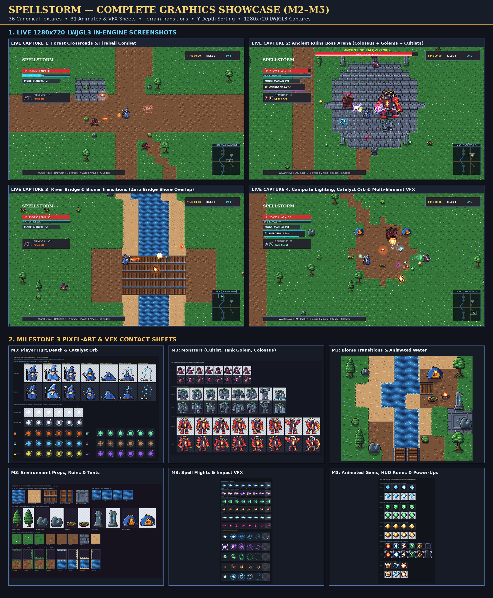
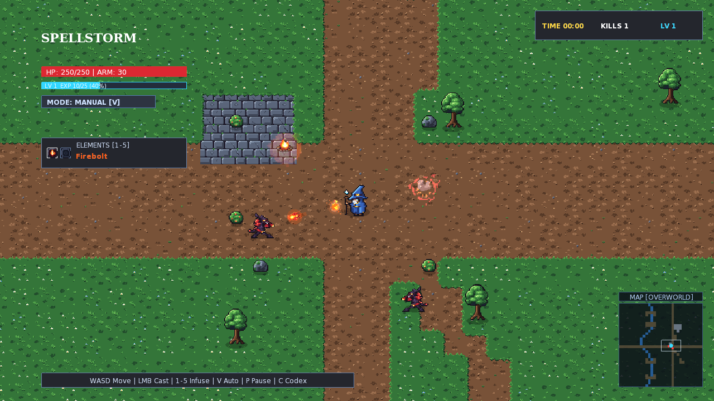
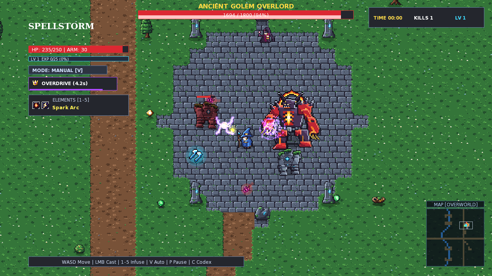
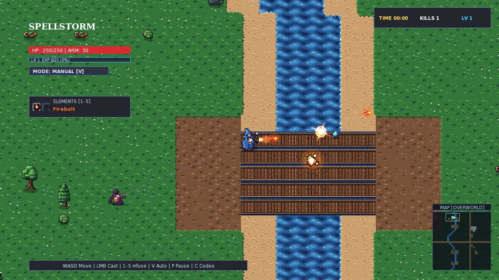
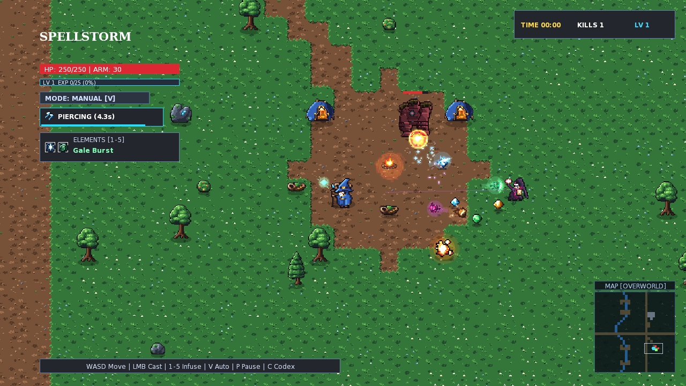

# Spell Storm

A top-down elemental arena survivor (bullet-heaven action RPG) built with **Java 21**, **LibGDX 1.13.1**, and the **LWJGL3** desktop backend. Infuse five elemental affinities on the fly, weave dual-element spell combinations, kite monsters across a river-divided overworld, draft 7-rank upgrade perks, collect temporary power-ups, and defeat the **Ancient Golem Overlord** boss.

> **Migration Notice:** This repository's default branch (`main`) hosts the active **Java 21 + LibGDX** implementation with the completed **M2–M5 2D Pixel-Art & VFX Pipeline**. The original **C++17 + SFML 2.6** codebase remains intact in Git history on the [`legacy-cpp-archive`](../../tree/legacy-cpp-archive) branch and `v0.9.0-cpp-final` tag.

---

## Screenshots

### Complete Graphics Overview (M2–M5)


### Live 1280×720 Gameplay Captures

| Forest Crossroads & Campfire Glow | Ancient Ruins Boss Arena (`--scenario m5-boss`) |
| :---: | :---: |
|  |  |

| River Bridges & Biome Transitions | Elemental Spells & Campsite (`--scenario m5-elements`) |
| :---: | :---: |
|  |  |

Animated pixel-art sprite previews and biome transition contact sheets are archived under [`docs/previews/milestone3/`](docs/previews/milestone3/) (including [`boss_colossus_anim.gif`](docs/previews/milestone3/boss_colossus_anim.gif), [`vfx_all_elements_showcase.gif`](docs/previews/milestone3/vfx_all_elements_showcase.gif), and [`biome_transitions_preview.png`](docs/previews/milestone3/biome_transitions_preview.png)).

---

## Project Introduction

### Gameplay & Implemented Features
- **On-the-Fly Elemental Weaving**: A 2-slot infusion buffer (`1`–`5`) lets you fire 5 base elemental spells or combine elements dynamically into dual-element spells (`SpellRegistry`, 15 pairings).
- **Enemy Archetypes & Boss Encounters**: Escalating spawner waves pit you against **Abyssal Claw Fiends** (melee), **Ranged Cultists** (kiting caster with cast telegraph), **Tank Golems** (armored brute), and the timed **Ancient Golem Overlord** boss (`1800 HP`, 3-way spread volley) guided by an 8-way Octile **A\* pathfinder** with corner-cutting prevention.
- **4096×4096 Overworld**: Deterministic `128×128` tile world featuring meadows, dirt paths, cobblestone courtyard ruins, wilderness campsites, a winding sinusoidal river, and 5 wide wooden bridges with generous boss clearance.
- **Progression & Power-Ups**: Collect tiered EXP gems (**Cyan**, **Emerald**, **Gold**), draft 3-choice upgrade cards with wrapped perk text across 7 rank-capped perks, and pick up temporary 5.0-second battlefield boosts (**Arcane Overdrive**, **Piercing Surge**, **Elemental Burst**).
- **Complete Desktop App Shell**: `START` title screen, `PLAYING`, `PAUSED`, Settings/Codex/Tutorial modal overlays, fixed `1280×720` screen-space HUD + minimap, `GAME_OVER` summary, and deterministic restart/replay seeds.

---

## Technology Stack

| Component | Technology |
| :--- | :--- |
| **Language & Runtime** | Java 21 LTS (Gradle `JavaLanguageVersion.of(21)` toolchain) |
| **Game Framework** | LibGDX `1.13.1` (`gdx`, `gdx-backend-lwjgl3`, `gdx-freetype`) |
| **Desktop Windowing / GL** | LWJGL3 (`FitViewport` at `1280×720` base, fullscreen `F11` support) |
| **Build Tool** | Gradle `8.10.2` (self-contained Gradle Wrapper `./gradlew` / `gradlew.bat`) |
| **Testing & CI Verification** | JUnit 5 (`5.10.2`) + LibGDX `gdx-backend-headless` & Mock `GL20` |

---

## Setup and Execution

### Prerequisites
- **Java 21 JDK** (e.g., Eclipse Temurin 21). If multiple JDKs are installed on your machine, ensure `JAVA_HOME` points to JDK 21 or let Gradle's toolchain auto-detection locate your JDK 21 installation.
- An **OpenGL-capable desktop session** is required for launching the graphical window (`./gradlew run` / JAR). All **automated tests** and **`--headless` verification** execute cleanly without a display or GPU.

### Clone, Build, Test & Run

```bash
# 1. Clone the repository
git clone https://github.com/manhkien0710-collab/SpellStorm.git
cd SpellStorm

# 2. Run the full automated JUnit 5 test suite (headless)
./gradlew test --console=plain

# 3. Build the project and package the standalone executable Fat JAR
./gradlew build

# 4. Run headless asset verification (validates all 41 canonical runtime assets & exits 0)
./gradlew run --args="--headless"

# 5. Launch the game via Gradle
./gradlew run

# 6. Or run the packaged Fat JAR directly (with optional CLI flags)
java -jar build/libs/SpellStorm-1.0.0-all.jar
java -jar build/libs/SpellStorm-1.0.0-all.jar --seed 42 --width 1920 --height 1080
```

#### Platform Notes
- **Linux**: `./gradlew run` extracts LWJGL natives automatically on launch. Works on X11 and XWayland sessions.
- **macOS**: `build.gradle` automatically appends `-XstartOnFirstThread` to JVM arguments when launching on macOS.
- **Windows**: Use `gradlew.bat` in place of `./gradlew` (e.g., `gradlew.bat test build` and `gradlew.bat run`).

| Useful Verification Commands | Purpose |
| :--- | :--- |
| `./gradlew test --tests "com.spellstorm.p2.ToolingP2Test" --console=plain` | Run a targeted test class |
| `./gradlew run --args="--seed 12345 --debug"` | Launch with deterministic seed and debug overlay hotkeys |
| `./gradlew run --args="--scenario m5-boss"` | Launch directly into the Ancient Golem Overlord arena scenario |
| `./gradlew run --args="--scenario m5-elements"` | Launch multi-element VFX & campsite showcase scenario |

---

## Graphics & Visual Pipeline (M2–M5)

All runtime sprites use strict **Nearest-Neighbor (`TextureFilter.Nearest`)** pixel filtering over a consistent `32×32` world tile grid (`1280×720` `FitViewport`), paired with soft additive blending (`GL_SRC_ALPHA, GL_ONE`) for spells, impacts, campfire illumination, and active aura glows:

- **Player & Animated Catalyst Orb**: 8-frame directional sheets (`player_{down,up,left,right}_sheet.png`), `player_hurt_death_sheet.png`, and a 6-frame pixel-art `catalyst_orb_sheet.png` dynamically tinted to the equipped spell's primary elemental color.
- **Monsters & Boss**: Canonical static textures plus 8-frame animated sheets (`melee_fiend_sheet.png`, `ranged_cultist_sheet.png`, `tank_golem_sheet.png`, `boss_colossus_sheet.png`) supporting idle, locomotion, and windup/attack telegraph frames.
- **Biome Transitions & Animated Water**: Deterministic coordinate-hash terrain variants (`terrain_variants_sheet.png`), 4-frame animated river water (`water_sheet.png`), cardinal Grass overhangs (`N/E/S/W`), and cardinal Sand/Shoreline banks (`terrain_transitions_sheet.png`) that cleanly exclude river bridge spans.
- **Y-Depth Sorting & Lighting**: Unified ground-anchor comparator (`GameScreen.Y_DEPTH_COMPARATOR`) sorts visible props (`Obstacle`), enemies, and the player in one pass with elliptical prop drop shadows plus warm flickering additive campfire floor lighting.
- **HUD Icons & Gems**: Shimmering 12-frame `gems_anim_sheet.png` pickups, crisp `hud_elements_sheet.png` elemental rune medallions in slot UI, and `powerup_icons_sheet.png` badges.

Editable sprite grids, Pixelbolt `.fx.json` recipes, palette definitions (`arcane_storm_palette.json`), and generation scripts live under [`assets/sources/`](assets/sources/). See [`docs/ART_STYLE_GUIDE.md`](docs/ART_STYLE_GUIDE.md) and [`assets/README.md`](assets/README.md) for regeneration commands and external pixel-art skill setup (`pixel-art-studio`, `pixelbolt`).

---

## Controls

| Input | Action |
| :--- | :--- |
| `WASD` / `Arrow Keys` | Move wizard (8-directional normalized movement) |
| `Mouse Move` | Aim spell direction in world space |
| `Left Mouse Button` (`LMB`) | Cast active spell (hold for continuous casting in Manual mode) |
| `1` – `5` | Infuse element into active 2-slot spell mix (`1` Fire, `2` Ice, `3` Lightning, `4` Wind, `5` Earth) |
| `V` | Toggle Shooting Mode (`MANUAL` vs `AUTO` aim-and-fire) |
| `P` / `ESC` | Pause / Resume match, or close active Settings / Codex / Quit Confirmation overlay |
| `C` | Toggle the Elemental Codex overlay (spells & power-ups reference) |
| `F11` | Toggle Fullscreen / Windowed display mode |
| `Mouse Wheel` / `+` / `-` | Adjust camera zoom (`[0.75, 2.25]`, default `1.35`) |
| `Enter` / `1`–`3` (Level-Up) | Select and confirm an upgrade perk card |
| `SPACE` / `H` / `L` (`--debug` only) | Debug shortcuts: self-damage (`SPACE`), heal (`H`), grant +40 EXP (`L`) |

---

## Elemental Spell Recipes (15 Pairings)

Spell Storm uses a **2-slot infusion buffer** controlled by keys `1`–`5`. `SpellRegistry.resolve(mix)` inspects the two most recently infused elements: if they form a registered order-independent pair (`ElementSet`), the combination spell is cast; otherwise, the base spell of the most recently infused element is cast.

### 5 Fundamental Base Spells

| Key | Element | Spell Name | Profile (`Dmg / Spd / Rad / Life / CD / Pierce`) | On-Hit Effect |
| :---: | :--- | :--- | :--- | :--- |
| `1` | **Fire** | **Firebolt** | `1.0x / 1.2x / 9.0px / 2.0s / 1.0x / 0` | `BurnEffect`: `0.5x` base DPS for `3.0s` (true damage ticks every `0.5s`) |
| `2` | **Ice** | **Frost Shard** | `0.8x / 1.4x / 8.0px / 2.0s / 0.8x / 1` | `SlowEffect`: reduces target movement speed by `50%` for `2.5s` |
| `3` | **Lightning** | **Spark Arc** | `1.1x / 1.8x / 7.0px / 1.5s / 0.9x / 0` | `ChainEffect`: jumps up to `3` targets within `160px`, dealing `0.7x` damage each |
| `4` | **Wind** | **Gale Burst** | `0.7x / 1.5x / 10.0px / 1.8s / 0.7x / 2` | `KnockbackEffect`: pushes hit enemies back (`280` impulse) |
| `5` | **Earth** | **Boulder Slam** | `1.6x / 0.8x / 13.0px / 2.2s / 1.4x / 0` | `KnockbackEffect`: heavy impact pushback (`180` impulse) |

### 10 Dual-Element Combinations (3 Registered + 7 Fallback Pairings)

| Pair | Recipe | Resolved Spell (`SpellRegistry`) | Effect & Behavior |
| :---: | :--- | :--- | :--- |
| `1 + 4` | **Fire + Wind** | **Firestorm (Fire + Wind)** | `1.5x` dmg, `1.3x` spd, `12.0px` rad, `2.0s` life, `1.2x` CD, `1` pierce. `AreaEffect(90px)` dealing `1.2x` area damage + `Burn(0.4x DPS, 2.5s)`. |
| `2 + 3` | **Ice + Lightning** | **Frost Tempest (Ice + Lightning)** | `1.3x` dmg, `1.4x` spd, `10.0px` rad, `2.0s` life, `1.1x` CD, `1` pierce. `AreaEffect(75px)` applying `Slow(60%, 3.0s)` to all foes in blast. |
| `5 + 1` | **Earth + Fire** | **Magma Core (Earth + Fire)** | `1.8x` dmg, `0.9x` spd, `14.0px` rad, `2.4s` life, `1.3x` CD, `0` pierce. Applies lingering `Burn(0.7x DPS, 4.0s)` + `Knockback(220)`. |
| `1 + 2` | **Fire + Ice** | *Fallback to newest element* | Resolves to **Frost Shard** (`1 -> 2`) or **Firebolt** (`2 -> 1`). |
| `1 + 3` | **Fire + Lightning** | *Fallback to newest element* | Resolves to **Spark Arc** (`1 -> 3`) or **Firebolt** (`3 -> 1`). |
| `2 + 4` | **Ice + Wind** | *Fallback to newest element* | Resolves to **Gale Burst** (`2 -> 4`) or **Frost Shard** (`4 -> 2`). |
| `2 + 5` | **Ice + Earth** | *Fallback to newest element* | Resolves to **Boulder Slam** (`2 -> 5`) or **Frost Shard** (`5 -> 2`). |
| `3 + 4` | **Lightning + Wind** | *Fallback to newest element* | Resolves to **Gale Burst** (`3 -> 4`) or **Spark Arc** (`4 -> 3`). |
| `3 + 5` | **Lightning + Earth** | *Fallback to newest element* | Resolves to **Boulder Slam** (`3 -> 5`) or **Spark Arc** (`5 -> 3`). |
| `4 + 5` | **Wind + Earth** | *Fallback to newest element* | Resolves to **Boulder Slam** (`4 -> 5`) or **Gale Burst** (`5 -> 4`). |

---

## Temporary Power-Ups

Ground power-ups spawn periodically in the arena and grant a **5.0-second** combat buff when collected. Collecting the same type refreshes the timer back to `5.0s`; collecting a different type replaces the active ability; pausing freezes the timer; and the HUD badge blinks when `< 4.0s` remain.

| Enum (`PowerUpType`) | Display Name | Modifier |
| :--- | :--- | :--- |
| `ARCANE_OVERDRIVE` | **ARCANE OVERDRIVE** | `+80% Spell Firing Rate` (cast cooldown multiplied by `1 / 1.8`) |
| `PIERCING_SURGE` | **PIERCING SURGE** | `+2 Projectile Piercing Hits` (total pierce capped at `3`) |
| `ELEMENTAL_BURST` | **ELEMENTAL BURST** | `Empowered Twin Elemental Blast` (`+1` extra projectile, `1.35x` damage, `+3px` radius) |

---

## CLI Tooling Flags

All flags are parsed by `EngineConfig.fromArgs(String[])` and consumed by `DesktopLauncher` / `SpellStormGame`:

| Flag | Description |
| :--- | :--- |
| `--headless` | Verify all 41 canonical runtime assets (36 `TextureId` PNGs, 3 TTF fonts, `DejaVu-LICENSE.txt`, `assets/README.md`) without opening a window and exit `0`. |
| `--autoplay` | Enable automated targeting/casting and automatic Level-Up card selection during test/demo runs. |
| `--seed <long>` | Set a deterministic world/spawner/upgrade RNG seed (displayed on the Title and Pause screens). |
| `--scenario <name>` | Launch a named deterministic verification scenario (`m5-boss`, `m5-elements`, etc.; legacy `--test-*` flags also map to `--scenario`). |
| `--screenshot <path>` | Save a PNG screenshot of the backbuffer to `<path>`. |
| `--screenshot-at <sec>` | Capture the `--screenshot` output after `<sec>` elapsed seconds. |
| `--debug` | Enable debug hotkeys (`SPACE`, `H`, `L`) and debug HUD telemetry. |
| `--width <px>` | Override initial window width in pixels (default: `1280`). |
| `--height <px>` | Override initial window height in pixels (default: `720`). |
| `--quit-after <sec>` | Automatically exit the application after `<sec>` elapsed seconds. |

---

## Development Roadmap

### Completed
- **Core Java 21 + LibGDX Port (Milestones M1–M8)**: Full parity port of simulation math, A* octile navigation, collision resolution, combat & status effects, enemy spawner scaling, Ancient Golem Overlord boss, EXP & 7-rank perk progression, and temporary power-ups.
- **Phase 2 Polish & Desktop App Shell**: Real Title/Pause/Settings/Codex/Tutorial/GameOver state machine, resize-safe `FitViewport` unprojection, rebalanced wave curve, and Fat JAR distribution packaging.
- **2D Graphics & Animation Pipeline (Milestones M2–M5)**: Unified Arcane Storm pixel-art palette, animated hero/monster/boss/VFX/HUD/terrain sheets, cardinal biome transitions & animated river water with bridge clearance, Y-depth sorting + drop shadows, animated Catalyst Orb, campfire lighting glow, and live 1280×720 verification captures.

### Planned
- **[Planned] Infinite Procedural World Generation**: Chunk-streamed infinite world expansion beyond the fixed `128×128` arena, featuring deterministic chunk seeding across seamless biome regions, dynamic river/landmark continuity, and streaming A\* navigation grids.

---

## Legacy C++ Version

The original **C++17 + SFML 2.6** implementation (`CMakeLists.txt`, `include/`, `src/`, `tests/`) is preserved in full Git history on the archival branch [`legacy-cpp-archive`](../../tree/legacy-cpp-archive) and tag `v0.9.0-cpp-final`:

```bash
# View or check out the archived C++ implementation
git fetch origin legacy-cpp-archive --tags
git checkout legacy-cpp-archive
```

---

## Documentation

- [Core System Architecture](docs/ARCHITECTURE.md)
- [Unified Art Style Guide](docs/ART_STYLE_GUIDE.md)
- [Phase 2 Architecture & Tuning Guide](docs/PHASE2.md)
- [Feature Parity Checklist](docs/FEATURE_PARITY_CHECKLIST.md)
- [C++ to Java Migration Mapping](docs/MIGRATION_MAPPING.md)
