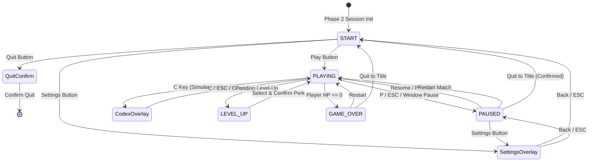

# Spell Storm — Phase 2 Architecture & Design Guide

Phase 2 upgrades **Spell Storm (Java 21 + LibGDX)** from a Phase 1 feature-parity port into a complete playable desktop game with an interactive App Shell, resolution-independent `FitViewport` scaling, tuned combat pacing, non-overlapping HUD telemetry, player guidance overlays, and clean asset packaging.

---

## 1. Phase 2 Architecture Overview

Phase 2 preserves the Phase 1 **Pure Simulation Decoupling** contract (`math`, `world`, `navigation`, `entities`, `combat`, `systems` remain 100% headless-testable) while adding five coordinated subsystems:

1. **App Shell & Lifecycle (`core`, `desktop`, `ui`)**:
   - `ViewportManager`: Virtual `1280x720` `FitViewport` with letterboxing and consistent `screenToUi` / `screenToWorld` unprojection.
   - `TitleScreen`, `PauseMenuOverlay`, `SettingsOverlay`: Complete start/pause/settings/quit-confirmation navigation loop.
   - `EngineConfig` & `DesktopLauncher`: `--seed <long>`, `--debug`, `--scenario <name>`, `--screenshot-at <sec>`, `--width <px>`, `--height <px>`, and legacy `--test-*` flag delegation.
2. **HUD & Minimap Layout (`HudRenderer`, `MinimapRenderer`)**:
   - Compact non-overflowing text inside `vitalsBar` (`260x18`), `expBar` (`260x12`), `shootingBadge` (`204x22`), and `powerUpBadge` (`230x34`).
   - Added Stats Panel (`MM:SS` survival timer, kills, level), Element Slots + Active Spell Panel, Controls Hint Footer Bar, and `< 4.0s` power-up blink (`[0.35f, 1.0f]`).
   - `MinimapRenderer` places `"MAP [OVERWORLD]"` strictly outside/above the `150x150` minimap box and draws a clamped camera viewport rectangle, boss markers, and power-up markers.
3. **Combat Balance & Presentation (`BalanceConfig`, `EnemySeparationSystem`, `Enemy`, `Player`, `EnemySpawner`)**:
   - `BalanceConfig.defaults()` tunes movement speeds, boss volley cadence, initial wave spawning, and spawn ring distance while `BalanceConfig.legacy()` and legacy default constructors preserve all 817 baseline tests.
   - `EnemySeparationSystem` prevents living enemies from stacking onto identical coordinates while respecting `worldBounds` and `TileMap` traversability.
   - Upright enemy rendering (`rotation = 0`, `flipX = enemy.isFacingLeft()`) and stable single-frame player walk rendering eliminate sprite spinning and frame-1 flicker.
4. **Player Guidance Overlays (`CodexOverlay`, `TutorialOverlay`, `ControlsOverlay`)**:
   - In-game elemental spell & power-up Codex (`C`), auto-fading 8.0s Tutorial banner, and shared `ControlsOverlay` bindings table.
5. **Asset Packaging Hygiene & Docs (`docs/`, `README.md`)**:
   - Development contact sheet moved from `assets/textures/contact_sheet_p0.png` to [contact_sheet_p0.png](contact_sheet_p0.png) so `fatJar` only packages runtime game assets (`36` `TextureId` PNGs, `3` TTF fonts, `DejaVu-LICENSE.txt`, `assets/README.md`).

---

## 2. App Shell State Flow

Phase 2 introduces `GameSession.createPhase2Session(SpellRegistry, Long explicitSeed)` alongside untouched legacy constructors (which still start directly in `PLAYING` with seed `42` and `debugMode = true` for Phase 1 test compatibility).

### Simulation Freeze Rules
- **Active Simulation (`PLAYING` only, with no modal overlay open)**: Player movement, `EnemySpawner`, AI steering, `EnemySeparationSystem`, `CombatSystem`, `ExperienceSystem`, `PowerUpManager`, and `matchElapsed` tick normally.
- **Frozen Simulation (`START`, `PAUSED`, `LEVEL_UP`, `GAME_OVER`, or when `CodexOverlay` / `SettingsOverlay` is open)**: World physics, enemy spawning, status ticks, and temporary power-up countdowns are completely suspended.
- **Debug Key Gating**: `SPACE` (self-damage), `H` (heal), and `L` (grant EXP) are gated behind `debugMode` (enabled via `--debug` in Phase 2 sessions).

---

## 3. FitViewport Unprojection (`ViewportManager`)

Phase 1 assumed a raw `1280x720` window for UI input coordinates (`new Vector2D(screenX, screenY)`), which broke button hitboxes and mouse aiming when resized to `1920x1080`, `2560x1440`, or non-16:9 aspect ratios.

Phase 2's `ViewportManager` fixes both coordinate spaces around a virtual `1280x720` reference frame:
- **Virtual UI Space**: `FitViewport(1280f, 720f, uiCamera)` scales the `1280x720` UI canvas uniformly to fit any window dimension and pads excess horizontal or vertical margins with black letterbox/pillarbox bars (`glClear` over full backbuffer before applying viewport).
- **UI Unprojection (`screenToUi(screenX, screenY)`)**: Transforms raw desktop pixel coordinates through the `FitViewport` into virtual `[0..1280] x [0..720]` Y-down UI coordinates, ensuring all buttons, hover states, and modal overlays align accurately at `1280x720`, `1920x1080`, `2560x1440`, and ultrawide/tall windows.
- **World Unprojection (`screenToWorld(GameCamera, screenX, screenY)`)**: First maps raw window coordinates into the `FitViewport`'s virtual `[0..1280] x [0..720]` viewport, then unprojects through `GameCamera` (accounting for camera position and zoom `[0.75, 2.25]`) so spell aiming always hits the exact cursor target in world space.

---

## 4. `BalanceConfig` Comparison (Phase 1 Legacy vs. Phase 2 Defaults)

`BalanceConfig.legacy()` preserves Phase 1 values for baseline regression tests, while `BalanceConfig.defaults()` tunes combat responsiveness and pacing for Phase 2 gameplay:

| Parameter | Phase 1 (`legacy()`) | Phase 2 (`defaults()`) | Design Rationale |
| :--- | :---: | :---: | :--- |
| `playerSpeed` | `230.0f` | `230.0f` | Preserved responsive baseline wizard mobility |
| `meleeSpeed` | `140.0f` | `185.0f` | Swarm fiends close gaps faster without overtaking player |
| `rangedSpeed` | `110.0f` | `160.0f` | Cultists reposition cleanly to preferred kiting band |
| `tankSpeed` | `80.0f` | `120.0f` | Golems apply steady forward pressure |
| `bossSpeed` | `55.0f` | `100.0f` | Ancient Golem Overlord remains threatening on open terrain |
| `bossHp` / `bossArmor` / `bossRadius` | `1800 / 45 / 50` | `1800 / 45 / 50` | Boss durability & bridge clearance geometry preserved |
| `bossVolleyCooldown` | `4.0s` | `3.2s` | Tighter 3-way arcane spread cadence |
| `initialSpawnDelay` | `1.5s` (1 enemy) | `1.2s` (`<= 2.0s`) | Immediate action on match start |
| `initialWaveMin` / `initialWaveMax` | `1` / `1` | `2` / `3` | Opening wave engages player promptly |
| `minSpawnDistance` / `maxSpawnDistance` | `>= 450px` (camera ring) | `380.0f` – `520.0f` | Reliable engagement ring near visible perimeter |
| `baseSpawnInterval` -> `minSpawnInterval` | `2.2s` -> `0.55s` | `1.6s` -> `0.5s` | Smoother early tempo and denser late-game escalation |
| `baseMaxEnemies` -> `maxEnemiesCap` | `20` -> `36` | `20` -> `40` | Slightly higher peak swarm density over `120.0s` ramp |

Additional Phase 2 simulation/visual polish:
- **`EnemySeparationSystem`**: Iterates over living enemies with deterministic tie-breaking when centers coincide (`dist == 0`), pushes overlapping bodies apart, and validates resulting positions against `worldBounds` and `TileMap.isTraversable`.
- **Sprite Presentation**: Enemies track horizontal facing (`enemy.isFacingLeft()`) and render upright (`rotation = 0`, `flipX = enemy.isFacingLeft()`) with ground shadows and compact overhead HP bars; `Player` uses single-frame walk rendering by default to prevent frame-1 sprite flicker.

---

## 5. Phase 2 Overlays & HUD Widgets

### App Shell & Modal Overlays
| Component | Trigger / State | Key Capabilities |
| :--- | :--- | :--- |
| `TitleScreen` | `GameState.START` | Play, Settings, Quit + Quit Confirmation dialog; displays active Run Seed. |
| `PauseMenuOverlay` | `P` / `ESC` during `PLAYING` | Resume, Restart, Settings, Quit to Title + Quit Confirmation; displays Run Seed & match stats. |
| `SettingsOverlay` | From Title or Pause | Fullscreen toggle (`F11` parity), `ControlsOverlay` bindings table, Back button. |
| `CodexOverlay` | `C` key | Lists all 15 elemental pairings/spells from `SpellRegistry` with color swatches & stats, plus all 3 `PowerUpType` entries. |
| `TutorialOverlay` | Match start / reset | 3-line goal banner fading over/after `8.0s` (`DEFAULT_DURATION`), dismissible via click, `SPACE`, or `ENTER`. |
| `ControlsOverlay` | Shared widget | Canonical keybinding rows (`WASD / Arrows`, `Left Mouse`, `1 - 5`, `V`, `P / ESC`, `C`, `F11`) and compact hint bar text. |
| `LevelUpOverlay` | `GameState.LEVEL_UP` | Existing 3-card two-step selection modal, now fed unprojected `uiMouse` via `ViewportManager`. |
| `GameOverOverlay` | `GameState.GAME_OVER` | Existing summary & Restart/Quit modal, now fed unprojected `uiMouse` via `ViewportManager`. |

### Phase 2 HUD & Minimap Additions
- **Non-Overlapping HUD Zones (`1280x720` virtual space)**:
  - Top-center Boss Bar remains at `x = [360..920]` (`560x22`).
  - Bottom-right Minimap remains at `(1110, 545)` (`150x150`), with `"MAP [OVERWORLD]"` moved strictly above the box (`getMinimapLabelBounds`), plus a clamped camera viewport rectangle, boss marker, and power-up markers.
  - Left-column HUD (`x = 75`) renders compact vitals (`vitalsBar`), compact EXP (`expBar`), shooting mode badge (`MODE: AUTO/MANUAL [V]`), color-coded blinking power-up badge (`< 4.0s` blink), Stats Panel (`MM:SS`, kills, level), and Element Slots + Active Spell panel without clipping or overlapping the Boss Bar or Minimap.
  - Bottom Controls Hint Bar (`ControlsOverlay.getCompactHintBarText()`) provides persistent one-line keybind recall.
