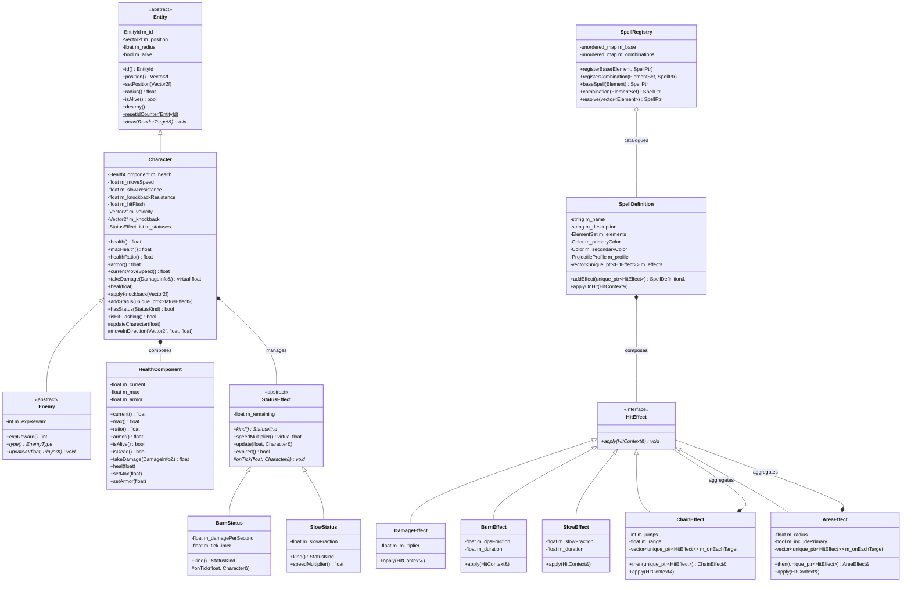
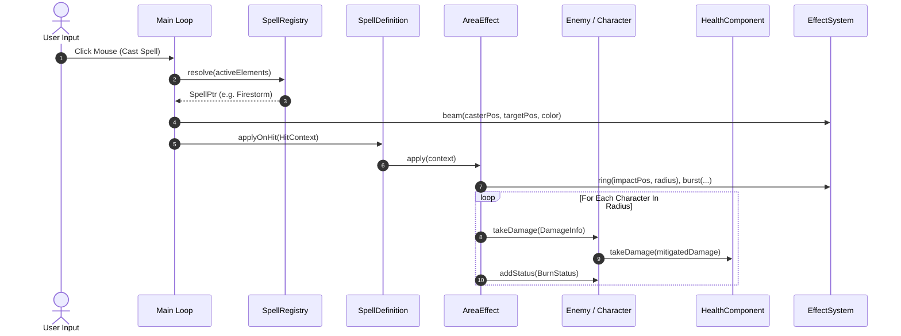

# Software Architecture & Design Specification

This document provides the formal architectural specification of **Spell Storm**, including UML class diagrams, design patterns, subsystem boundaries, and object lifecycle workflows.

---

## 1. Architectural Overview

Spell Storm is structured using a **layered, component-oriented 2D architecture** designed to decouple domain gameplay mechanics from graphics/input presentation.

```mermaid
flowchart TD
    subgraph Presentation_Layer ["Presentation & Input Layer (SFML)"]
        Window["sf::RenderWindow"]
        DrawUtils["DrawUtils (Procedural Rendering)"]
        ResMgr["ResourceManager (Font Cache)"]
        VFX["EffectSystem (Particles, Beams, Rings)"]
    end

    subgraph State_Layer ["State Management Layer"]
        Stack["StateStack"]
        StateBase["State (Abstract)"]
    end

    subgraph Domain_Entities ["Domain Entities Layer"]
        EntityBase["Entity (Abstract ID & Transform)"]
        CharacterBase["Character (Mobile Combatant)"]
        EnemyBase["Enemy (AI Target)"]
        PlayerWiz["PlayerWizard"]
    end

    subgraph Combat_Subsystem ["Combat & Status Subsystem"]
        HealthComp["HealthComponent (Armor & Vitality)"]
        StatusList["StatusEffectList"]
        StatusBase["StatusEffect (Abstract)"]
        BurnEff["BurnStatus"]
        SlowEff["SlowStatus"]
    end

    subgraph Spell_Engine ["Spell & Composition Engine"]
        SpellReg["SpellRegistry"]
        SpellDef["SpellDefinition"]
        HitEffBase["HitEffect (Strategy Interface)"]
        DmgEff["DamageEffect"]
        BurnEffHit["BurnEffect"]
        SlowEffHit["SlowEffect"]
        ChainEff["ChainEffect (Composite)"]
        AreaEff["AreaEffect (Composite)"]
    end

    subgraph Progression_Subsystem ["Progression & Upgrade Subsystem"]
        ExpPickup["ExperiencePickup (Collectible Entity)"]
        ExpSys["ExperienceSystem (Magnetism & Collection)"]
        ProgressionComp["PlayerProgression (Curves, Multi-levels)"]
        UpMgr["UpgradeManager (Perks, Caps, Rolling)"]
        LevelModal["LevelUpOverlay (Pause & Choice UI)"]
    end

    Window --> Stack
    Stack --> StateBase
    StateBase --> Domain_Entities
    CharacterBase --> HealthComp
    CharacterBase --> StatusList
    StatusList --> StatusBase
    StatusBase --> BurnEff
    StatusBase --> SlowEff
    PlayerWiz -- "is-a" --> CharacterBase
    EnemyBase -- "is-a" --> CharacterBase
    CharacterBase -- "is-a" --> EntityBase
    ExpPickup -- "is-a" --> EntityBase

    ExpSys o-- ExpPickup
    ExpSys --> ProgressionComp
    ProgressionComp --> UpMgr
    UpMgr --> LevelModal
    LevelModal -. "modifies" .-> PlayerWiz

    SpellReg --> SpellDef
    SpellDef o-- HitEffBase
    HitEffBase <|-- DmgEff
    HitEffBase <|-- BurnEffHit
    HitEffBase <|-- SlowEffHit
    HitEffBase <|-- ChainEff
    HitEffBase <|-- AreaEff

    HitEffBase -. "calls" .-> VFX
    HitEffBase -. "applies to" .-> CharacterBase
```

---

## 2. UML Class Diagram

The following Mermaid class diagram illustrates the primary classes, inheritance hierarchies, interfaces, and composition relationships:



---

## 3. Subsystem Descriptions

### 3.1 Combat & Vitality Subsystem
- **`HealthComponent`**: Uses the Single Responsibility Principle (SRP) to encapsulate health, max health, armor calculations, damage absorption, and death status.
- **`DamageInfo`**: Value type conveying damage magnitude and whether it penetrates armor (`ignoreArmor`).
- **`StatusEffect`**: Extensible polymorphic base for timed status ailments. Does not depend on SFML Graphics; purely calculates gameplay effects (movement speed reductions, damage ticks).

### 3.2 Spells & Elemental Combination Engine
- **`Element` & `ElementSet`**: `ElementSet` encodes up to 32 elements using an order-independent bitmask (`m_mask`). This allows `{Fire, Wind}` and `{Wind, Fire}` to equate without sorting or giant switch statements.
- **`SpellDefinition`**: Immutable spell specification. Aggregates a `ProjectileProfile` and an ordered list of `HitEffect` objects.
- **`HitEffect` (Strategy & Composite Patterns)**:
  - Atomic strategies: `DamageEffect`, `BurnEffect`, `SlowEffect`, `KnockbackEffect`.
  - Composite strategies: `AreaEffect` and `ChainEffect`. Both can nest child `HitEffect` instances, allowing chains that cause burn, or explosions that apply slows.
- **`SpellRegistry`**: Factory/catalog storing base spells and combination recipes. Dynamically resolves element lists to the appropriate single or multi-element spell.

### 3.3 Visual Effect System (`EffectSystem`)
- Self-contained manager for transient visual feedback (expanding blast rings, lightning arcs, particle bursts).
- Follows RAII: particles and shapes expire and deallocate automatically based on individual timers.

---

## 4. Key Sequence: Spell Casting and On-Hit Resolution

The sequence below illustrates the flow when a spell is cast and triggers an area explosion that inflicts damage and status:



---

## 5. Memory Management & Object Lifetimes

1. **Exclusive Dynamic Ownership (`std::unique_ptr`)**:
   - `Character` uniquely owns each `StatusEffect` in its `StatusEffectList`.
   - `SpellDefinition` uniquely owns its `HitEffect` strategy chain.
   - `StateStack` uniquely owns states on the stack.
2. **Shared Immutable Ownership (`std::shared_ptr<const SpellDefinition>`)**:
   - Spells registered in `SpellRegistry` are wrapped in `std::shared_ptr<const SpellDefinition>`. Multiple projectiles, UI slots, and entities can reference the same spell definition safely without duplication or lifetime hazards.
3. **Non-Owning References & IDs**:
   - Entities reference other entities via `EntityId` (uint32_t) rather than raw pointers across frames. This prevents dangling pointers when an entity is destroyed during projectile flight or chain bounces.
